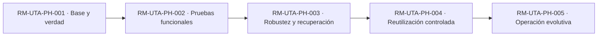
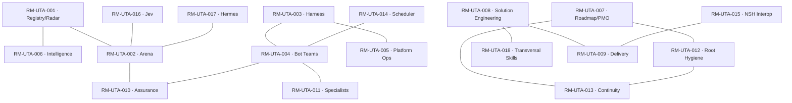
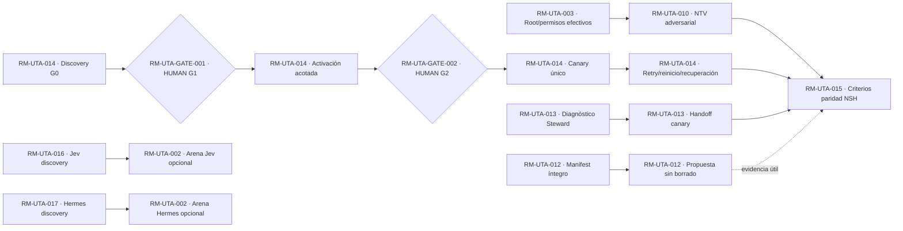
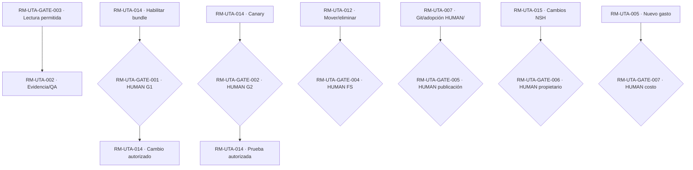

# Upgrade_TA — Roadmap integral de capacidades

**DOCUMENT_ID:** `RM-UTA-DOC-001`  
**Versión:** `2026-10-23.v0.7-INTEGRATED`  
**Ruta objetivo:** `HUMAN/ROADMAP.md`  
**Estado:** `HUMAN_CONTENT_APPROVED_LOCAL_OPERATIONAL_SOURCE`; HUMAN aprobó el contenido, la conciliación local en UTA037R, la normalización de BATON en UTA041, la consolidación documental/hardenización NTV en UTA044–049C (`SKILLS/INTERNAL/NTV.md`, `TOOLS/ntv_verify.py`), la corrección de no conformidad de límite de iteraciones de continuidad en UTA052 (`NC-MORCH-20261023-ITERATION_LIMIT`), y la integración controlada v0.7 (`UTA_ROADMAP_V07_INTEGRATION_20261023`), incorporando frentes multiproceso NTV01–NTV06 e higiene permanente T08. UTA048 permanece como `UNKNOWN_HOLD`. La publicación Git general permanece `NOT_AUTHORIZED`, salvo el piloto acotado de rama de revisión y Pull Request (`review/UTA-ROADMAP-V07-BRIDGE-001` / PR #1) explícitamente autorizado por HUMAN para recuperación de evidencia por MORCH (con merge estrictamente prohibido).  
**Skill transversal de referencia:** `20261017_Trans.ROADMAP_Skills.md` (criterio aprobado por HUMAN; existencia local de `SKILLS/TRANSVERSAL/ROADMAP.md` sin comprobar).  
**Skill interna:** `SKILLS/INTERNAL/UTA_ROADMAP.md` (HUMAN informa que colocó el archivo allí; contenido efectivo local aún no verificado).  
**Fuente estratégica:** `HUMAN/NORTH_STAR.md`, `HUMAN/UPGRADE_PLAN.md`. Este Roadmap es la **única planificación operativa activa local**; `UPGRADE_PLAN.md` conserva alcance estratégico y no emite un DAG concurrente. La adopción local no implica publicación Git.  
**Criterio de evidencia:** hechos de documentos GitHub y archivos adjuntos, declaraciones HUMAN, reportes DSHB, documentación pública y pruebas reales se distinguen explícitamente. Nunca asumir equivalencia entre un reporte y una comprobación externa.

## 01 — North Star y resultados observables

**North Star:** plataforma neutral de inteligencia y gestión del ciclo de vida de tecnologías de IA que **DESCUBRE → EVALÚA → REUTILIZA → CONFIGURA → INTEGRA → EXTIENDE → CONSTRUYE** sólo si es necesario. Entrega tecnologías calificadas, seguras, comparables, reproducibles, reversibles y útiles a proyectos consumidores; no se evalúa por la cantidad de bots, archivos o instalaciones.

**Beneficiarios:** HUMAN, MORCH/RORCH, equipos de proyectos usuarios y responsables de tecnologías. **Outcomes:** (O1) reducir tiempo hasta capacidad realmente validada; (O2) disminuir intervenciones/relay humanos innecesarios; (O3) mejorar robustez, recuperación y auditabilidad; (O4) evitar costes no aprobados y dependencias no verificadas; (O5) preservar portabilidad y límites de los proyectos. **No alcance:** Upgrade_TA no toma autoridad sobre NightShift (NSH), SkillsMachine o MOVEM; no se presume sustitución de NSH por DSHB. **Medida basal:** `UNKNOWN` salvo datos acotados y observados.

## 02 — Estado actual: verdad y límites

| REF_ID | Hecho/capacidad | Estado y procedencia | Lo que **no** demuestra |
|---|---|---|---|
| RM-UTA-003 | DSH `0.2.0-rc.2`, OmniRoute, ruta `omniroute1/Para_DSH`, DS Bot instalado | Configuración compartida por HUMAN, capturas y reportes del equipo; `USER_SUPPLIED` | Uso y facturación del proveedor subyacente, seguridad efectiva de todos los perfiles |
| RM-UTA-004 | Grupo `02_UTA` con Chief, ARCHITECT.UTA y REVIEWER.UTA; `ARCHITECT.UTA` oculto en sidebar | Creación confirmada por HUMAN; transcripción UTA034A de delegación | Paralelismo simultáneo, aislamiento adversarial, recuperación, escalabilidad |
| RM-UTA-010 | UTA034A Chief→ARCHITECT→REVIEWER→Chief, relay humano = 0 dentro de ese ciclo | `BOT_REPORTED` respaldado por transcripción HUMAN; revisión independiente **parcial** | NTV adversarial, integridad de filesystem, ausencia global de riesgos |
| RM-UTA-014 | UTA034B G0 identifica bundle `@deepseek-ai/dsh-experimental-schedule-bundle` con servicio `@deepseek-ai/dsh-schedule` | `BOT_REPORTED`, con segunda inspección reportada por REVIEWER | Bundle realmente activo; tarea programada real; coste cero |
| RM-UTA-013 | UTA035 identifica Context Steward, checkpoints, handoffs, memoria y mecanismos DSH | Documentación de producto + `BOT_REPORTED`; `checkRatio` predeterminado 0.8 según DS Bot | Ratio efectivo local, continuidad tras fallo, aislamiento por proyecto |
| RM-UTA-012 | Trabajo estructural T08 precedente UTA019/021 y propuestas de higiene | Documentos históricos y reportes | Inventario recursivo completo actual y limpieza autorizada |
| RM-UTA-007 | Skill interna `UTA_ROADMAP.md` ubicada por HUMAN en `SKILLS/INTERNAL` | `HUMAN_REPORTED` | Versión exacta de bytes locales y adopción Git |
| RM-UTA-016 | TypeSafe Jev / System One | Candidato de investigación; no conectado a DSHB | Benchmark independiente, licencia/precio, ventaja funcional |
| RM-UTA-017 | Hermes CLI | Smoke de CLI/doctor reportado en histórico | E2E real, scheduler sustituto, producción |
| RM-UTA-001 | Contratos Registry/Radar/Arena documentados | `REPO_DOCUMENTED` (GitHub consultado; remoto puede ir detrás del local) | Registro operativo actualizado automáticamente |

**Identidad:** root esperado `C:\01. GitHub\Upgrade_TA`, WSL `/mnt/c/01. GitHub/Upgrade_TA`, remote `PSM44/Upgrade_ToolsA`, branch `main`. `HEAD`, divergencia remoto/local, worktree, secretos, rutas completas y efectos de runtime **PENDING_EVIDENCE** al momento de adoptar. El paquete anterior citó HEAD remoto `649314b...`; no tratarlo como HEAD local actual. Conservación estricta de `HUMAN/`, Skills y demás fuentes. **No existe gate de Git o de cambio de DSH consumido por este documento.**

## 03 — Estado objetivo

**Producto objetivo:** inventario tecnológico y Radar con decisiones versionadas; Arena con reproducibilidad real y pruebas negativas; catálogo de capacidades reutilizables; Group Chats de proyecto con identidad y permisos probados; scheduler de disparo único y, sólo tras aceptación y coste acotado, periódico; continuidad de contexto/memoria con recuperación efectiva; clasificación permanente del root sin eliminación automática; MR0, HO.1 y Roadmap sincronizados; métricas y coste observables; contratos de integración y sustitución gradual **autorizada** en proyectos consumidores.

**Madurez L0–L6 (no redefinir):** L0 Conceptual; L1 Visual; L2 Funcional delimitado; L3 Integrado; L4 Operacional controlado; L5 Productivo; L6 Evolutivo. Etiquetas de evidencia como `MOCK_PASS`, `LAB_REAL_PASS`, `DSH_ORIGIN_E2E_PASS`, `REPORTED_ONLY` y `PRODUCTION_VERIFIED` son **otra dimensión**. No convertir un paquete instalado en L2 ni recuperación reportada en L4.

## 04 — Estrategia de evolución

Estrategia **product/outcome-first**. Reutilizar DSH/DSHB y herramientas existentes, demostrar las brechas y sólo entonces integrar, extender o crear. Ejecutar `GOALS → LOOPS → GRAPH/DAG → AGENTS/BOTS_WHEN_USEFUL → CROSS_CHECK → TERMINAL_CONVERGENCE`. Mantener frentes independientes concurrentes hasta gates genuinos; no crear dependencias falsas por secuencia narrativa. Cada iteración emite delta de capacidad, prueba y riesgo; una nueva idea se incorpora al módulo que le corresponde o queda en Radar/ARENA, sin abrir una rama infinita.

**Arquitectura de autoridad:** HUMAN > MORCH > RORCH > EXE en NSH; Chief es facilitador local, nunca sustituto de MORCH/RORCH. Revisión de otro bot no es por sí sola prueba de independencia. *Free-first*: cero **nuevos compromisos financieros** sin autorización, no cero tokens consumidos.

## 05 — Catálogo canónico de módulos

IDs de los 18 módulos provienen del Roadmap candidato 2026-10-17: **reservados, no renumerados**. Alias T01–T09 son funciones transversales dentro del producto y no IDs WBS nuevos. `OWNER` genérico es función propuesta, no un bot ya desplegado. La tabla es índice; fichas de aceptación abajo concretan entradas/salidas y evidencia.

| MODULE_ID | Capacidad / outcome | Alias | CURRENT → TARGET | Estado / dependencia sustantiva |
|---|---|---|---|---|
| RM-UTA-001 | Technology Registry + Radar trazable | REGISTRY | L0 → L6 | Contratos documentados, actualidad operativa pendiente |
| RM-UTA-002 | Arena y pruebas reproducibles | ARENA | L0 → L5 | Contrato; pruebas E2E transversales pendientes |
| RM-UTA-003 | Harness/DSH y routing verificados | HARNESS | L1* → L4 | UI/config compartida; seguridad/uso real pendientes |
| RM-UTA-004 | Group Chats y delegación entre bots | DSB TEAMS | L2* → L4 | UTA034A en alcance limitado, aislamiento pendiente |
| RM-UTA-005 | Operaciones de plataforma, perfiles y versiones | T01 | L0 → L4 | Inventario efectivo y rollback pendientes |
| RM-UTA-006 | Inteligencia y selección tecnológica | T02 | L0 → L6 | Radar/Registry como fuente de candidatos |
| RM-UTA-007 | Planificación integrada y DAG | T03 | L0 → L4 | Skill interna colocada por HUMAN; Roadmap aprobado como fuente operativa local en UTA037R |
| RM-UTA-008 | Ingeniería de soluciones y Skills | T04 | L0 → L4 | Reutilización contractual pendiente |
| RM-UTA-009 | Delivery e integraciones controladas | T05 | L0 → L4 | Ningún cambio en otros proyectos autorizado |
| RM-UTA-010 | QA, NTV y seguridad adversarial | T06 | L2* → L4 | Reviewer participó; prueba adversarial pendiente |
| RM-UTA-011 | Especialistas bajo demanda | T07 | L0 → L4 | Evaluación de aporte y límites, no proliferación |
| RM-UTA-012 | Inventario y orden físico del root | T08 | L0 → L4 | Manifest completo y cambios controlados pendientes |
| RM-UTA-013 | Context Steward, memoria y continuidad | T09 | L0 → L4 | Features documentadas; canary efectivo pendiente |
| RM-UTA-014 | Scheduler y disparos durables | SCHED | L0 → L4 | G0 reportado, G1/G2 pendientes HUMAN |
| RM-UTA-015 | Interoperabilidad y sustitución parcial de NSH | NSH | L0 → L4 | Contrato de paridad y autorización ajena |
| RM-UTA-016 | Jev / decisiones tipadas | JEV | L0 → L2 | Investigación/early access, no integración |
| RM-UTA-017 | Hermes comparativo | HERMES | L0 → L2 | CLI smoke; real E2E pendiente |
| RM-UTA-018 | Skills y normas entre proyectos | SKILLS | L0 → L4 | Gobierno de Skill transversal, promoción pendiente |

`*`: L1/L2 son estimaciones acotadas al **artefacto/función particular** (UI y turnos vistos), no madurez del módulo completo. Su ratificación en Arena queda `PENDING_EVIDENCE`.

**Contratos compartidos:** cada módulo mantiene `PURPOSE`, `BENEFICIARY`, `ENTRY_CRITERIA`, `EXIT_CRITERIA`, `OWNER`, `STATUS`, `DEPENDENCIES`, `DEPENDENCY_TYPE`, `PARALLEL_ELIGIBILITY`, `DELIVERABLES_VISUAL_FUNCTIONAL`, `EVIDENCE_REQUIRED`, `EVIDENCE_LEVEL`, `GATES`, `RISKS`, `ROLLBACK`, `NEXT_EXECUTABLE_NODE`; los campos aún no observables quedan `PENDING_EVIDENCE` y nunca se simulan. Productos de cada módulo: Registro/Radar versionado (001/006), Arena real (002/010), perfil/Group Chat e informes (003–005/011), Roadmap MR0 HO.1 (007), Skills/adaptadores (008/018), contrato de integración + rollback (009/015), manifiesto del root (012), checkpoint/reconstrucción (013), canary programado (014), informe comparativo Jev/Hermes (016/017).

## 06 — Diagramas contractuales con WBS visibles

**Regla:** alias de sintaxis Mermaid no es ID; la etiqueta muestra el ID de catálogo. Aristas sólidas representan **dependencia dura** en 6.3, puntadas representan relación funcional (no bloqueo) en 6.2. Todos los nodos no meramente descriptivos están registrados aquí en los catálogos de fases/gates/hitos y módulos.

### 6.1 — Progresión de fases (sin fechas inventadas)

La flecha **denota madurez de la etapa**, no exige detener frentes independientes mientras otros progresan.

### 6.2 — Mapa de módulos/capacidades (relaciones funcionales, no prerrequisitos)

### 6.3 — DAG de dependencias operativas reales (frentes paralelos)

Las repeticiones del mismo módulo en el DAG son **estados/tareas derivados dentro del módulo**; cada trabajo mantiene su TASK_ID (p. ej. UTA034B). El grafo presenta rutas paralelas y no hace depender Jev/Hermes del scheduler. La **paridad NSH de scheduler** requiere pruebas pertinentes de éste; la calificación NSH de otras capacidades puede avanzar antes.

### 6.4 — Mapa de gates y autoridades

## 07 — Fases y criterios de salida

| PHASE_ID | Outcome y entregable visible/funcional | Entrada | Salida verificable | OWNER | Estado |
|---|---|---|---|---|---|
| RM-UTA-PH-001 | Línea basal, Registry/Radar/Arena contractuales, root y catálogo identificados | identidad del proyecto | fuentes, rutas, baseline y contradicciones reconciliadas | MORCH/RORCH | PARCIAL: trabajo documental, estado local pendiente |
| RM-UTA-PH-002 | Group Chat/canaries delimitados que funcionan en alcance declarado | baseline y permisos de cada prueba | delegación y controles negativos con logs y costes | Chief + T06 | PARCIAL: UTA034A reportado |
| RM-UTA-PH-003 | T08/T09/scheduler con persistencia, fallos, recuperación, rollback | canaries positivos y gates correspondientes | reinicios, duplicados, pruebas de reconstrucción | RORCH + REVIEWER | NOT_READY |
| RM-UTA-PH-004 | Adaptadores y capacidad consumida por otro proyecto | paridad demostrada y autoridad del consumidor | contrato, pruebas, fallback, aceptación del proyecto propietario | Equipo consumidor | BLOCKED por paridad/gates |
| RM-UTA-PH-005 | Evolución, retirada y costes medidos | uso real autorizado | revisiones, métricas, retiradas reversibles y evidencias | MR0/owners | NOT_READY |

**Fases ≠ L0–L6:** las fases son etapas de implementación; L0–L6 describen madurez de un entregable. Para una fase, `DEPENDENCIES`, `GATES`, `EVIDENCE_REQUIRED`, `RISKS`, `NEXT_PHASE` quedan vinculados a los módulos y gates de §§05/09/10; responsable de cierre MORCH, sin presumir aprobación técnica o HUMAN.

## 08 — Hitos y catálogo de entregables inspectables

| MILESTONE_ID | Resultado a inspeccionar | Tipo, madurez objetivo | Qué se verá / qué funcionará | Qué NO se presume | Evidencia / estado |
|---|---|---|---|---|---|
| RM-UTA-MS-001 | Baseline de gobierno y contratos | documental/L0–L1 | políticas verificables y trazabilidad | Runtime operativo | REPO_DOCUMENTED |
| RM-UTA-MS-002 | Delegación `02_UTA` | L2 | transcripción de entrega/retorno entre tres bots | aislamiento, NTV adversarial | BOT_REPORTED; UTA034A |
| RM-UTA-MS-003 | Límites de identidad y permisos | L3 | pruebas negativas root y lectura no autorizada | cero violaciones sin pruebas | PENDING_EVIDENCE |
| RM-UTA-MS-004 | NTV adversarial | L2–L3 | fallo sembrado detectado/rechazado, fuentes citadas | efectividad por mera coincidencia | NOT_RUN |
| RM-UTA-MS-005 | Scheduler un disparo | L2→L3 | hora programada/real, entrega, log, coste | duración/recovery por canary | G0 reportado; G1/G2 pendientes |
| RM-UTA-MS-006 | T09 handoff reproducible | L3→L4 | checkpoint y nueva parte, reconstrucción con gates intactos | aislamiento de memoria sin prueba | NOT_RUN |
| RM-UTA-MS-007 | T08 manifiesto auditado | L2→L4 | inventario completo, clasificación, hash/links, deltas | autorización de limpieza | NOT_RUN íntegro |
| RM-UTA-MS-008 | Consumo NSH delimitado | L3→L4 | E2E desde proyecto autorizado, rollback y trazas | sustitución global NightShift | NOT_RUN |
| RM-UTA-MS-009 | Comparativa tecnología | L0→L2 | Arena Jev/Hermes y alternativas, costes y seguridad | integración DSH por anuncio | NOT_RUN |
| RM-UTA-MS-010 | Autonomía operacional | L4→L5 | duración, tolerancia a fallos, restitución y coste medidos | permiso 4H/24H o producción | NOT_RUN / HUMAN gate |

**Criterios de contrato por entregable:** `MODULE_ID`, `VERSION`, `BENEFICIARY`, `CURRENT/TARGET_MATURITY`, `VISIBLE_RESULT`, `FUNCTIONAL_RESULT`, `NOT_WORKING_YET`, `ACCEPTANCE`, `EVIDENCE_SOURCE`, `OWNER` son obligatorios en el paquete de ejecución de cada milestone. La tabla anterior constituye catálogo ejecutivo, no simula paquetes implementados.

## 09 — Dependencias y bloqueos

| REF_ID | Dependencia | Tipo | Efecto/alternativa |
|---|---|---|---|
| RM-UTA-GATE-001 | Identificación real del bundle (G0) antes de G1 | technical + HUMAN gate | G0 reportado; aún requiere propuesta, snapshot y aprobación |
| RM-UTA-GATE-002 | G1 verificado antes de tarea G2 | hard + HUMAN | canary no se configura por inferencia |
| RM-UTA-010 | NTV adversarial + pruebas de límites antes de aceptar autonomía supervisada | hard para aceptación; no para discovery | investigar en paralelo otras capacidades |
| RM-UTA-013 | Handoff real antes de afirmar continuidad durable | hard | Context Steward puede probarse independientemente |
| RM-UTA-012 | Manifest completo antes de proponer movimientos | hard para cleanup, no para otras tareas | clasificar sin alterar archivos |
| RM-UTA-015 | Prueba de paridad por componente + gate del consumidor antes de sustituir NSH | hard/gate | candidatos Jev y Hermes no bloquean DSHB |

## 10 — Gates, autorizaciones y límites

| GATE_ID | Autoridad | Alcance | Estado actual |
|---|---|---|---|
| RM-UTA-GATE-001 | HUMAN | UTA034B G1: habilitar bundle, posible reload DSH | NOT_AUTHORIZED |
| RM-UTA-GATE-002 | HUMAN | UTA034B G2: crear canary único + consumo acotado | NOT_AUTHORIZED |
| RM-UTA-GATE-003 | RORCH/MORCH dentro de scope | auditoría `READ_ONLY` sin acceso ajeno | ELIGIBLE con comprobación identidad |
| RM-UTA-GATE-004 | HUMAN | limpieza/movimiento/borrado físico en root protegido | NOT_AUTHORIZED |
| RM-UTA-GATE-005 | HUMAN | edición `HUMAN/`, stage/commit/push, despliegue | Edición acotada UTA037R autorizada; stage/commit/push/despliegue NOT_AUTHORIZED |
| RM-UTA-GATE-006 | HUMAN de proyecto consumidor | cambios NSH/SkillsMachine/MOVEM | NOT_AUTHORIZED |
| RM-UTA-GATE-007 | HUMAN | gasto nuevo/recurrencia sin presupuesto probado | NOT_AUTHORIZED |

**Prohibiciones:** no crear trabajos recurrentes, no lanzar prueba 4H, no limpiar automáticamente memoria/históricos, no hacer Git mutante, no cambiar DSH/OmniRoute productivos, no instalar plugins ni publicar por aprobación implícita. Los permisos efectivos de los bots deben comprobarse con pruebas adversariales, no por instrucciones textuales.

## 11 — Riesgos, supuestos y controles

| RISK_ID | Riesgo / hipótesis | Impacto | Mitigación / aceptación |
|---|---|---|---|
| RM-UTA-RISK-001 | Chief/Reviewer declaran PASS sin prueba primaria | aceptación inválida | trazas independientes, defectos sembrados, estados parciales |
| RM-UTA-RISK-002 | Memoria o bot compartidos cruzan proyectos | privacidad e identidad | probar separación, mínimos privilegios, no compartir memoria sensible |
| RM-UTA-RISK-003 | Root WSL/Windows o `wsl$` lleva a ruta ajena | lectura/escritura indebida | realpath, Git top-level/remote, boundaries, UNKNOWN_HOLD |
| RM-UTA-RISK-004 | Scheduler/despertares incurren tokens/coste | gasto/no disponibilidad | canary único, presupuesto, límites y cancelación |
| RM-UTA-RISK-005 | Handoff resume y omite autorización/riesgo | reanudación insegura | Quality Gate reconstrucción HO.1; histórico retenido |
| RM-UTA-RISK-006 | Root cleanup rompe enlaces o borra evidencia | pérdida irreversible | manifiesto, allowlist, backup, dry-run, HUMAN |
| RM-UTA-RISK-007 | Drift de bundle/modelo/provider | fallo de integración | pin de versiones, snapshot, restauración y prueba |
| RM-UTA-RISK-008 | Jev/Hermes claims se toman como capacidad probada | mala decisión tecnológica | comparativas Arena + precios/licencia y E2E |
| RM-UTA-RISK-009 | GitHub diverge del root local | sobrescritura de cambios | reconcilación previa + NO stage/push automático |

**Supuestos abiertos:** versión efectiva de Skill transversal local, ratio real del Context Steward, seguridad de aislamiento, coste de `Para_DSH`, cobertura total de directorios y realidad de cada gate; todos `PENDING_EVIDENCE`.

## 12 — DAG paralelo, ranking D5→D1 y recursos

| TASK_ID | MODULE_ID | Dificultad | Resultado / por qué | Responsable propuesto | Bot/SPECIALIST y alternativa | Gate | Paralelo |
|---|---|---|---|---|---|---|---|
| UTA-ROOT-ISOLATION | RM-UTA-003 | D5 | pruebas de fuga, identidad y permisos efectivos (riesgo transversal) | T06 | REVIEWER + especialista seguridad si aporta; alternativa pruebas manuales controladas | READ_ONLY antes de negativo invasivo | Sí |
| UTA-NSH-PARITY | RM-UTA-015 | D5 | matriz de paridad, autonomía y frontera de autoridad | MORCH + NSH owner | especialista runtime si necesario | HUMAN consumidor para mutación | Sí, diseño |
| UTA034B-G1G2 | RM-UTA-014 | D4 | servicio + canary real, presupuesto, rollback | Chief coordinador | ARCHITECT/REVIEWER; alternativa operador HUMAN | GATE-001/002 | Preparación sí; ejecución gated |
| UTA035-CANARY | RM-UTA-013 | D4 | compactación y handoff durable, memoria aislada | T09 | REVIEWER + experto sesiones según necesidad | permisos y snapshots | Sí |
| UTA-NTV-ADVERSARIAL | RM-UTA-010 | D3 | detectar un defecto deliberado sin autorrevisión | REVIEWER | ARCHITECT propone, REVIEWER rechaza; alternativa experto externo | READ_ONLY | Sí |
| UTA-T08-MANIFEST | RM-UTA-012 | D3 | manifest completo y seguro, no mover | T08 | ARCHITECT/reviewer; alternativa inventario script read only | READ_ONLY | Sí |
| UTA-JEV-QUAL | RM-UTA-016 | D2 | oportunidad de decisiones tipadas, seguridad, precio, integración | T02 | especialista modelo opcional | Sin proveedor pagado | Sí |
| UTA-HERMES-QUAL | RM-UTA-017 | D2 | cron/agent parity experimental | T02 | specialist CLI opcional | Sólo discovery | Sí |
| UTA-ROADMAP-VALIDATE | RM-UTA-007 | D2 | validar referencias y evidencia del documento | T03/Reviewer | validador determinista + NTV | HUMAN para adopción | Sí |

**Todos los `TASK_ID` de nueva creación son identificadores candidatos, no se presentan como tickets existentes.** Fichas D5–D1 detalladas deben definir INPUTS, COMPLEXITY_RATIONALE, ACCEPTANCE, TIMEOUT, RETRY, COST_LIMIT, TRACE_ID, evidencias, idempotencia y rollback antes de ejecutarse. Capacidad de los bots se evalúa, no se presupone; `HUMAN_RELAY_COUNT=0` en UTA034A no implica autonomía completa.

**DAG habilitado sin gate adicional:** investigación de Context Steward, manifest READ_ONLY T08, NTV adversarial sintético, evaluación de Jev/Hermes, verificación efectiva de root/SKill, validación de catálogo. **Bloqueado:** activar Automation Tasks, lanzar canary con modelo, cualquier cambio de Git/proyecto, limpieza o costo nuevo. Si una prueba READ_ONLY puede disparar acciones indirectas, requiere nueva autorización específica.

## 13 — Métricas y evidencia

| METRIC_ID | Métrica / método de observación | Línea basal | Outcome |
|---|---|---|---|
| RM-UTA-MET-001 | HUMAN_RELAY_COUNT / transcript causal por tarea | UTA034A reportado 0, solo ese ciclo | Menos relay |
| RM-UTA-MET-002 | Independencia NTV / porcentaje de defectos sembrados detectados | UNKNOWN | QA efectivo |
| RM-UTA-MET-003 | ROOT_COVERAGE / manifest completo y límites de symlinks | UNKNOWN | higiene |
| RM-UTA-MET-004 | HANDOFF_RECONSTRUCTION_PASS / prueba en sesión limpia | NOT_RUN | continuidad |
| RM-UTA-MET-005 | SCHEDULE_DELIVERY / timestamps intentado vs efectivo, duplicados | NOT_RUN | scheduling |
| RM-UTA-MET-006 | COST_PER_VALIDATED_CAPABILITY / logs+tarifa/ruta | UNKNOWN | coste sostenible |
| RM-UTA-MET-007 | CROSS_PROJECT_POLICY_VIOLATIONS / pruebas negativas y trace | UNKNOWN | aislamiento |
| RM-UTA-MET-008 | ROLLBACK_SUCCESS / drill y verificación post | UNKNOWN | resiliencia |
| RM-UTA-MET-009 | TIME_TO_VALIDATED_CAPABILITY / entrada y aceptación versionada | UNKNOWN | velocidad útil |

**Registro mínimo de evidencia:** `EVIDENCE_ID`, `MODULE_ID`, `TASK_ID`, fuente/procedencia, fecha local+zona o UTC, entorno, comandos/logs, hash, limitaciones, prueba independiente, resultado, coste medido, autorizaciones. Registros reportados sin trazas `REPORTED_ONLY`; no declarar `0` costo por ausencia de factura.

## 14 — Cadencia de revisión

`MR0` operacional semanal y revisión de cartera mensual según contrato estratégico; inspección extraordinaria ante incidente, nuevo gasto, vulnerabilidad, deriva o cambio de autoridad. El Roadmap cambia por modificación de módulos, outcomes, dependencies, gates, riesgo y madurez. La sincronización con HO.1 es por evento material de continuidad, no un resumen obligatorio en cada llamada del modelo. No inventar fecha de hitos ni ciclos de cuatro horas.

## 15 — Control de cambios, higiene y convergencia

Una verdad activa al adoptar. Registro semántico deltas; no renumerar `RM-UTA-001..018`, ni borrar antecedentes ni modificar retrospectivamente evidencia. T08 mantiene `ROOT_HYGIENE_STATUS`, `NEW_ARTIFACTS`, `DUPLICATES`, `UNCLASSIFIED`, `CLEANUP_PROPOSALS`, `AUTHORIZED_EFFECTS`; T09 clasifica memoria vigente/obsoleta y checkpoint sin eliminación física. Validador estructural + verificación semántica y adversarial. Estado final permitido: `REJECTED_AS_INCOMPLETE_ROADMAP`, `CANDIDATE_READY_FOR_HUMAN_REVIEW`, `ADOPTED_WITH_EVIDENCE` sólo con gate. El archivo nuevo no prueba aún adopción ni modifica repo.

## 16 — Próximas acciones / cartera única de ejecución

| NODE_ID | MODULE_ID | Frente paralelo / próximo acto comprobable | Estado / gate |
|---|---|---|---|
| RM-UTA-WS-001 | RM-UTA-007 | Mantener consistencia de Skill interna, IDs y Roadmap aprobado local; Quality Gate semántico | UTA037R reconciliado; futuras escrituras requieren HUMAN |
| RM-UTA-WS-002 | RM-UTA-014 | Reconciliar G0 con servicio efectivo, rollback y tareas persistidas; presentar autorización G1 | READY READ_ONLY / STOP HUMAN G1 |
| RM-UTA-WS-003 | RM-UTA-010 | Sembrar y rechazar falso PASS en datos sintéticos, probar root equivocado | READY con alcance READ_ONLY |
| RM-UTA-WS-004 | RM-UTA-013 | Diagnóstico real de steward/memoria y prueba de checkpoint autorizada | DISCOVERY READY, canary gate aparte |
| RM-UTA-WS-005 | RM-UTA-012 | Manifest recursivo del root con límites, hashes y unknown-hold | READY READ_ONLY |
| RM-UTA-WS-006 | RM-UTA-016 | Jev en Registry/Radar: acceso/precio/schemas/bench independiente | READY DISCOVERY |
| RM-UTA-WS-007 | RM-UTA-017 | Hermes cron/adapters frente a DSH y alternativas | READY DISCOVERY |
| RM-UTA-WS-008 | RM-UTA-015 | Contrato de paridad parcial NightShift, sin cambios a NSH | READY DESIGN; gate consumidor posterior |
| RM-UTA-WS-009 | RM-UTA-003 | GitHub Operational Bridge: canal versionado de evidencia y PR | PILOT ACTIVE en review/UTA-ROADMAP-V07-BRIDGE-001 (PR #1); no merge |
| RM-UTA-WS-010 | RM-UTA-002 | Vertical Slices, TDD y verificación de producto | READY / aplicándose a UTA051 / RIRE v0.1 |
| RM-UTA-WS-011 | RM-UTA-003 | Skills Manager: evaluación aislada en entorno de laboratorio | READY / onlineUpdate=false |
| RM-UTA-WS-012 | RM-UTA-012 | Gobernanza del ciclo de vida de Git refs y NTV_ROOT | READY / inventario y clasificación recursiva |

**Convergencia:** sólo cerrar el alcance demostrablemente completo, con evidencia, los bloqueos explícitos, comparación frente a alternativa y siguientes nodos. Priorizar cerrar pilotos cortos (NTV, canary Scheduler) antes de expandir sin fin el inventario tecnológico. Paralelizar discovery no exige ejecutar en producción.

## 17 — Registro de decisiones

| DECISION_ID | Decisión/estado | Autoridad/evidencia |
|---|---|---|
| RM-UTA-DEC-001 | `02_UTA` creado; demás grupos al trabajarlos; ARCHITECT oculto, REVIEWER creado — CONFIRMADO | HUMAN conversación |
| RM-UTA-DEC-002 | T08/T09 capacidades distintas, coordinación transversal — DISEÑO ACEPTADO | HUMAN conversación / propuesta |
| RM-UTA-DEC-003 | DSHB complementa o sustituye componentes sólo con pruebas de paridad — POLÍTICA | North Star y HUMAN |
| RM-UTA-DEC-004 | Scheduler G0 discovery; G1/G2 requieren autorizaciones separadas — GATES ABIERTOS | HUMAN/UTA034B |
| RM-UTA-DEC-005 | Context Steward reuse-before-build, no bot transversal nuevo sin gap — CANDIDATO | UTA035 reportado |
| RM-UTA-DEC-006 | Esquema IDs `RM-UTA-*` extendido por tipo, sin renumerar módulos — APROBADO | HUMAN conversación |
| RM-UTA-DEC-007 | Skill interna en `SKILLS/INTERNAL/UTA_ROADMAP.md`, Roadmap nuevo en `HUMAN/ROADMAP.md`, UPGRADE_PLAN referencia — APROBADO | HUMAN conversación |
| RM-UTA-DEC-008 | Aprobar el contenido y adoptar este documento como fuente operativa local — **HUMAN_APPROVED**; stage/commit/push/tag — **NOT_AUTHORIZED** | HUMAN UTA037R; gate Git separado |
| RM-UTA-DEC-009 | Integración controlada Roadmap v0.7 (`UTA_ROADMAP_V07_INTEGRATION_20261023`) ejecutada con autorización de alcance HUMAN, coordinación/revisión MORCH y ejecución AgentTeams — APROBADO (merge prohibido) | HUMAN autorizado / MORCH coordinado / AgentTeams ejecutado |

## 18 — Apéndice, referencias y conservación histórica

**Tipos de IDs declarados:** Módulos `RM-UTA-001…018`; fases `RM-UTA-PH-001…005`; gates `RM-UTA-GATE-001…007`; hitos `RM-UTA-MS-001…010`; riesgos `RM-UTA-RISK-001…009`; workstreams `RM-UTA-WS-001…008`; decisiones `RM-UTA-DEC-001…009`; métricas `RM-UTA-MET-001…009`. Ninguno se considera históricamente adoptado sin reconciliación del root. **Deprecated IDs:** ninguno confirmado; no reciclar IDs candidatos retirados.

**Fuente de verdad de evidencia histórica:** `CONTINUITY/BATON/` (ubicación canónica aprobada de continuidad; contenido preservado), `CONTINUITY/STATE.md`, UTA019/021/034A/034B/035 (reportes), `HUMAN/NORTH_STAR.md`, `HUMAN/UPGRADE_PLAN.md`, `HUMAN/MR0/MR0.md`, `CONTINUITY/HO1/HO1_CONTRACT.md`, `RADAR/RADAR_POLICY.md`, `ARENA/ARENA_CONTRACT.md`. El estado GitHub publicado puede estar retrasado frente al local. **No ejecutar `git add -A`, push ni cambio en otro repo por la existencia de este Roadmap.**

**Referencias externas candidatas:** DeepSeek-Bot GitHub (funcionamiento documentado); TypeSafe Jev, early access sin integración; Hermes como herramienta a calificar. **HO.1/MR0:** reconciliados localmente por UTA037R bajo autorización HUMAN; su publicación Git, recuperación blank-session y cualquier promoción de evidencia conservan gates separados.
