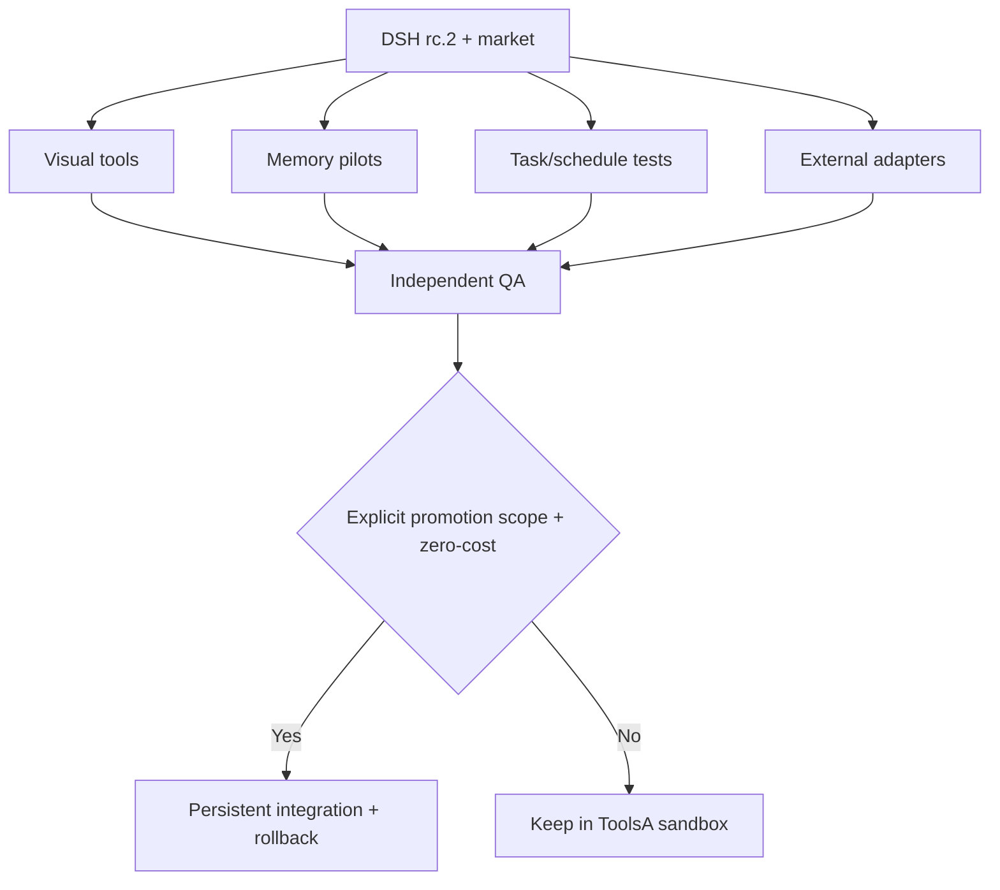

# UTA018 — Selection, Integration and Diagram Module

**Status:** PROPOSAL, not execution authorization. Upgrade_TA is a shared evaluation repository; NightShift's ToolsArena is distinct.

## Parallel GOALS
- **G1 VISUAL:** Archify already listed → verify real diagram; Mermaid CLI → versioned static SVG; ECharts → interactive data chart. Prefer zero-cost local binaries.
- **G2 MEMORY:** LINGSHU isolated read-only as first new candidate; OpenViking in second isolated profile; compare memory from identical synthetic cases. Existing Hindsight coding-agent extension is not proof of a working Hindsight backend. Do not enable dual auto-memory injection on one production profile.
- **G3 TASKS:** validate installed Task Board + dsh-proactive + PUA. Ensure only one authority controls retries and timers. Suspend autonomous model-funded verifier until the user approves a cap.
- **G4 ADAPTERS:** EverOS/Composio stable lab → native DSH-originated read-only invoke; Hermes adapter after successful bounded CLI tool run; OpenHands after official rootless runtime.
- **G5 CROSS_CHECK:** compare functional, security, restart, rollback, accuracy, costs and provenance; apply GOALS/LOOPS/DAG/NTV independently.

## Dependencies

## Terminal convergence
For each tool report: exact artifact hash; license; security review; actual DSH invocation if destination DSH; sample output; baseline pre/post; negative test; restart; cost and quota; rollback drill; `REAL_PASS/MOCK_PASS/NOT_TESTED/BLOCKED`; evidence path. Installed UI icon alone does not suffice.
